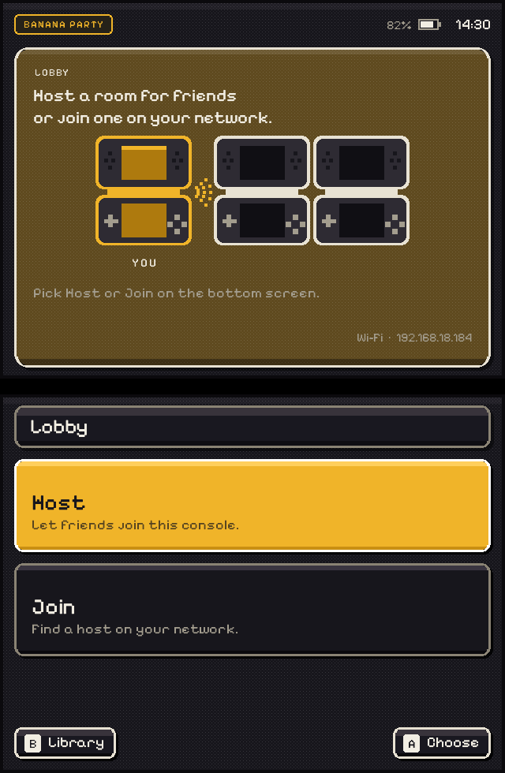
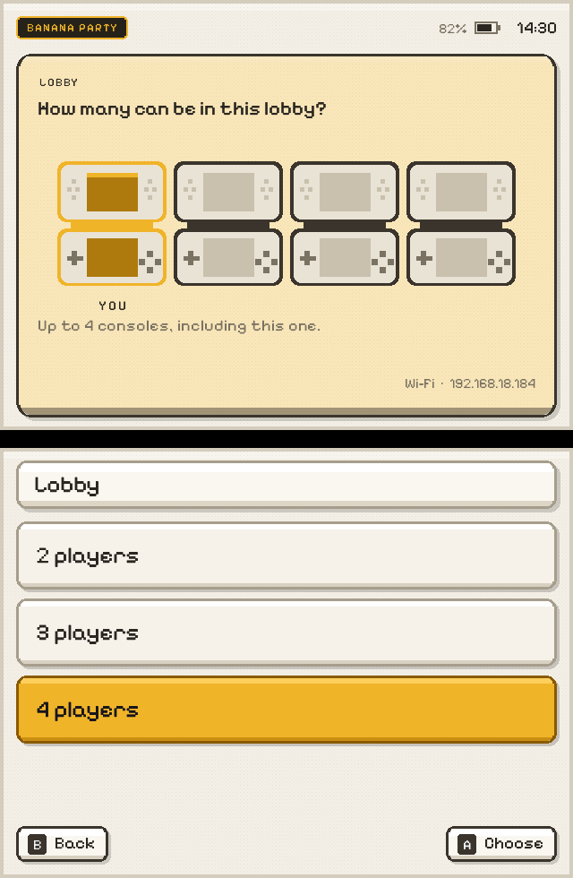
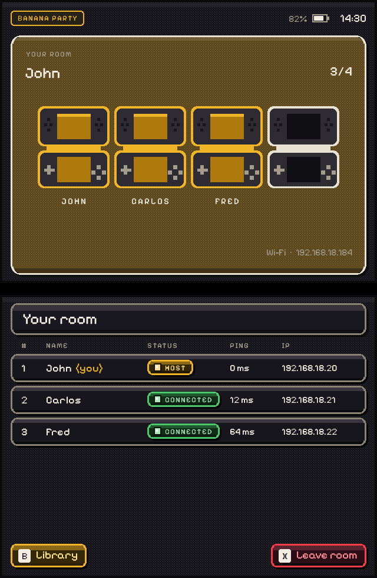
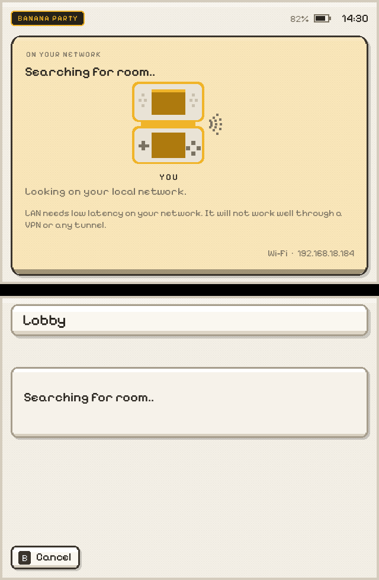
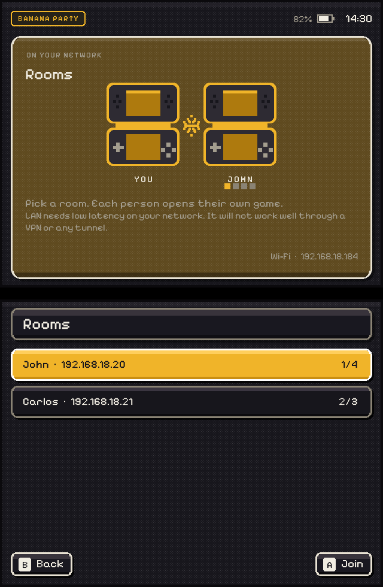
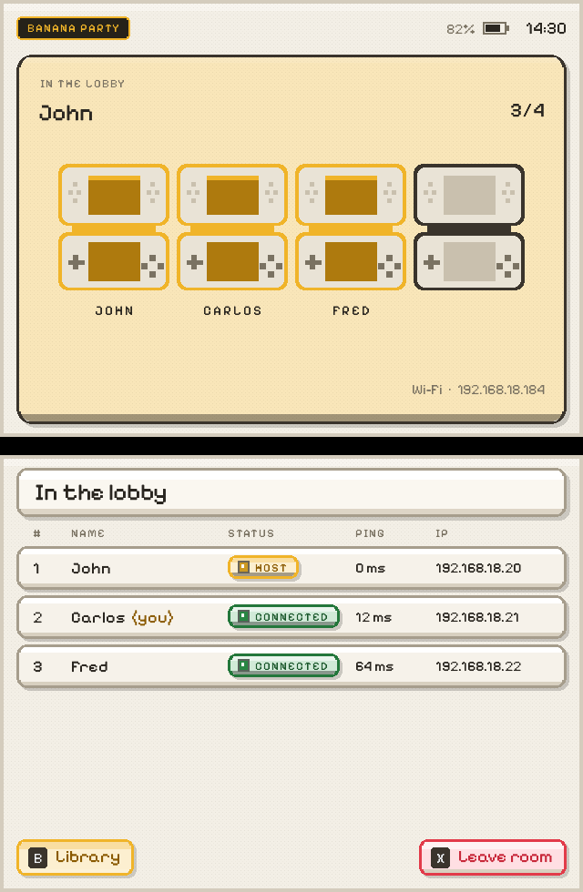
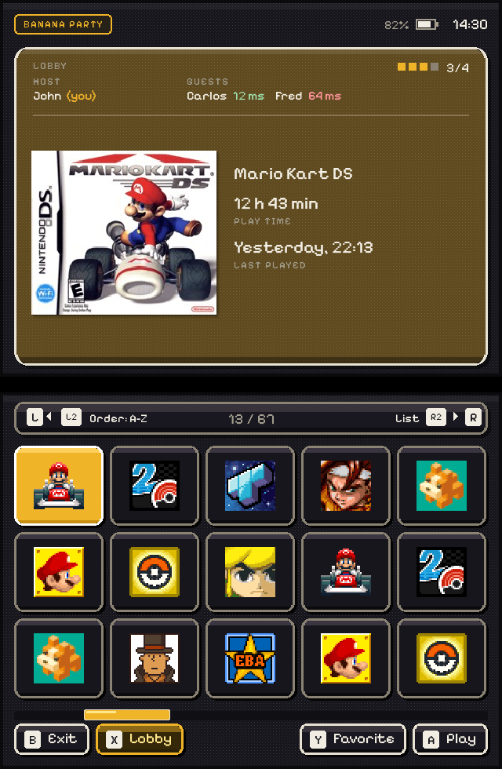
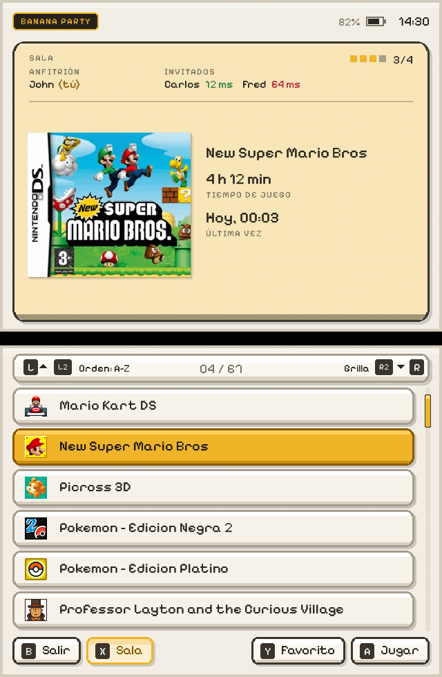

# Banana Party

  <b>A pixel game library for BananaOS — grid or list, favorites, recents, and launch on the shelf.</b>

  <a href="#at-a-glance">At a glance</a> ·
  <a href="#get-it-on-your-card">Get it on your card</a>

## Screens

You open Banana Party and the room is the first decision. This console can host, or it can join a room that is already on the same Wi-Fi. Light and dark are the same night, just two moods.

A host sets the seats, and the room is open. Friends on the network can see it. A guest looks, picks a room, and lands inside with everyone else. The library is right there: covers when you want the shelf, a list when you want the titles lined up. English or Spanish. The room stays with you while you choose what to play.

<table>
  <tr>
    <td align="center" width="25%">
       
      <b>Host, or join</b>
    </td>
    <td align="center" width="25%">
       
      <b>Set the seats</b>
    </td>
    <td align="center" width="25%">
       
      <b>The room is open</b>
    </td>
    <td align="center" width="25%">
       
      <b>Looking nearby</b>
    </td>
  </tr>
  <tr>
    <td align="center" width="25%">
       
      <b>Rooms on the Wi-Fi</b>
    </td>
    <td align="center" width="25%">
       
      <b>You're in</b>
    </td>
    <td align="center" width="25%">
       
      <b>The library, as covers</b>
    </td>
    <td align="center" width="25%">
       
      <b>The library, as a list</b>
    </td>
  </tr>
</table>

## At a glance

- 📚 **Library** on the Apps shelf — grid or list, favorites, play time, saves, and covers.
- 🎮 **Launch and return** — pick a game, play on the bundled emulator build, come back to the same row.
- 🔊 **Menu sounds** and touch-friendly rails, in **English** or **Spanish**.
- 💾 **Saves** on the card at `/data/saves/nds` (shared with the system save folder).
- 🔄 **Updates** from inside the app when a release is available.

## Get it on your card

**Option A — one installer file**

1. Download **Install-Banana-Party.sh** from the release.
2. Copy it into **store/tiles** on the shared **banana** folder (do not replace the whole **store** folder).
3. Reboot once, open **Apps**, and run the installer tile.

**Option B — full zip**

1. Download the release zip and extract it.
2. Copy **banana-party** into **store/apps** and **Banana Party.sh** into **store/tiles** (do not replace the whole **store** folder).
3. Reboot once, then open **Apps**.

After either option, leave **Apps** and open **Apps** again so the list refreshes (temporary BananaOS limitation).

More steps (file sharing, copying from a computer, etc.) are in `INSTALL.txt`.

## Remove it

1. Open the app, then press **START** to open **Settings**.
2. Press **Y** for **Uninstall**, then **A** to confirm.

The app removes its folder and tile.

## Built with

Open source (GPL v3). On-screen UI in C. **Banana Party** is what you install on the shelf. Packaging uses the local draft when `../bananads-lan/dist/bananads` is present, and otherwise the published release named in `app/manifest` (checked against `binary_sha`). `emu/lobby.nds` is copied only when that file is already on the machine. Neither file is stored in git. The player is not a second Apps app. See `build/package.sh` and `build/selftest.sh`.

## Credits

**Pixelado Dev** — built with AI-assisted development, reviewed on real hardware when possible. Provided as-is; see `LICENSE`.